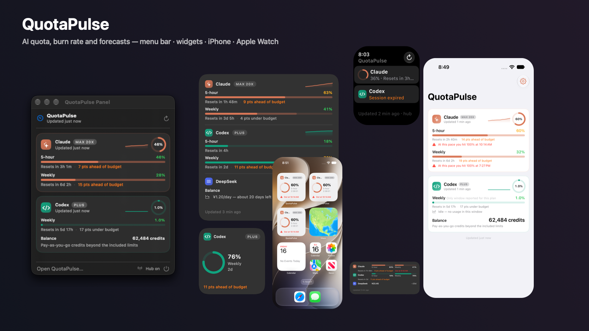
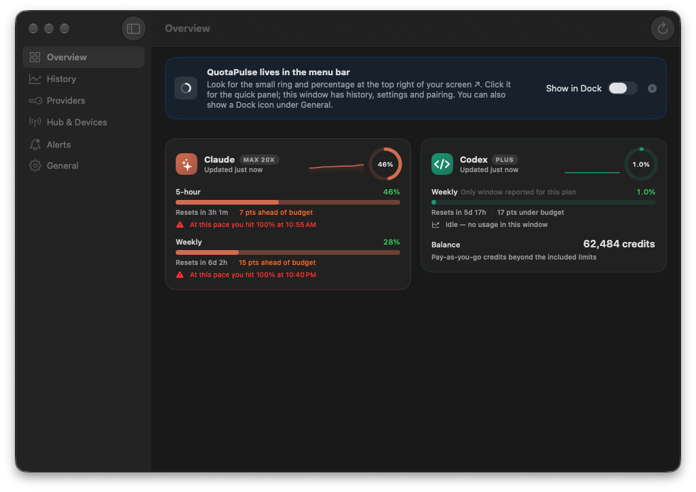
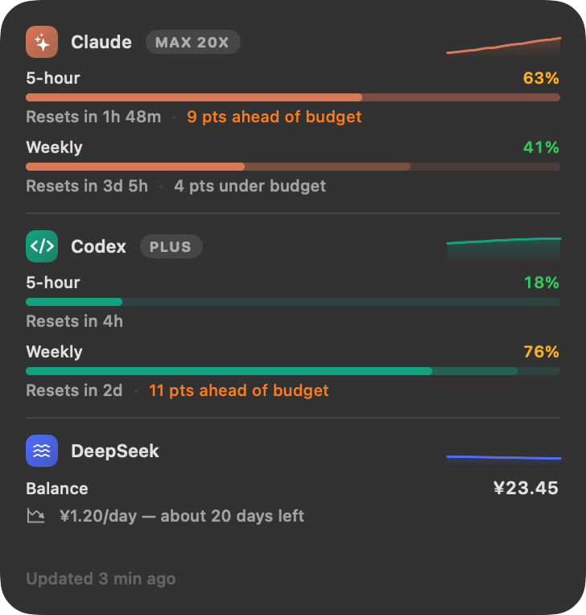
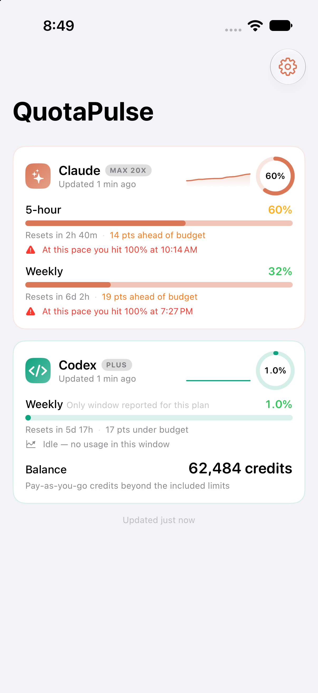
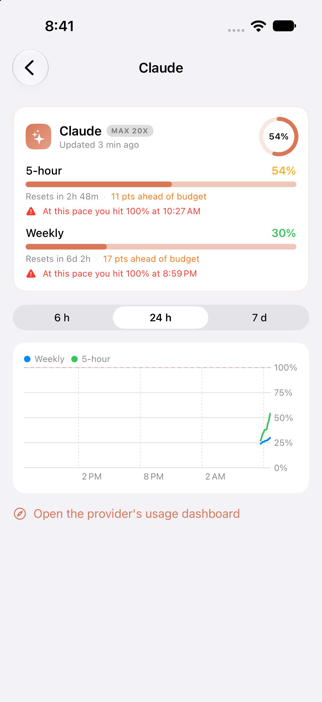
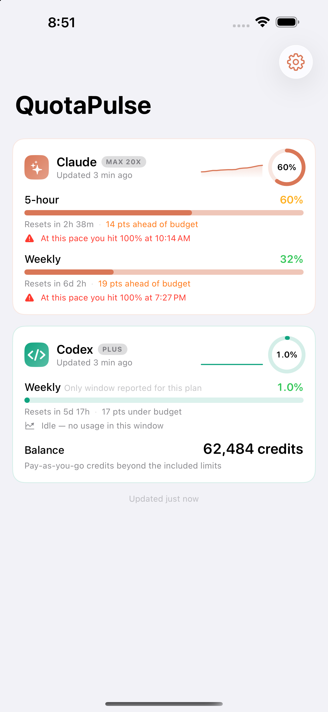
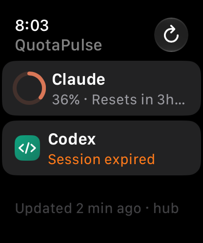
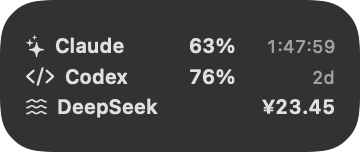

# QuotaPulse

**How much AI do I have left, and when does it run out?** — answered in the macOS menu bar, on the desktop, on your iPhone's home screen and on your wrist.

QuotaPulse watches the rate-limit windows and balances of the AI providers you already use — **Claude** (Claude Code subscription), **OpenAI Codex** (ChatGPT subscription), **DeepSeek** (prepaid balance), **OpenCode Zen/Go** and **GLM / z.ai** — and turns the raw percentages into something actionable:

- *"At this pace you hit 100 % at 18:40 — reset is at 21:00"*
- *"9 pts ahead of budget"* / *"On pace"*
- *"¥1.20/day — about 20 days left"*

Everything runs on your own machines. Your Mac is the **hub**: it reads the credentials your CLIs already keep locally, polls the providers, stores the history and serves a tiny authenticated JSON API over LAN / Tailscale. The iPhone and Apple Watch apps only ever see those numbers — never a token.

| macOS menu bar | macOS main window | History & forecast |
|---|---|---|
|  |  |  |

| Desktop widgets | iPhone 17 · iOS 27 | iPhone 17 · detail | iPhone 17 · home-screen widgets |
|---|---|---|---|
|   |  |  |  |

| iPhone 15 Plus · iOS 26.5 | iPhone 15 Plus · dark, XXL text | Pairing | Apple Watch + complications |
|---|---|---|---|
|  |  |  |    |

Screenshots come from the running apps: the Mac itself, iPhone 17 (iOS 27.0) and iPhone 15 Plus (iOS 26.5 and 27.0) simulators, the watchOS 27 simulator; home-screen widgets were added through the real widget gallery by `QuotaPulseUITests`. Lock-screen accessory widgets and watch complications are rendered from the real widget views (`swift run WidgetRender`).

## Compatibility

| Platform | Verified on | Notes |
|---|---|---|
| macOS | 27.0.1 (Mac mini M4) | Menu bar app + desktop widgets; min macOS 26.0 |
| iOS | **iPhone 17 / iOS 27.0** · **iPhone 15 Plus / iOS 26.5** (API-equivalent to 26.6.2) · iPhone 15 Plus / iOS 27.0 · iPhone Duo / iOS 27.1 | Home, detail, pairing, settings, home-screen widgets, Dynamic Type XXL, dark mode; min iOS 26.0, no iOS-27-only API |
| watchOS | Apple Watch Series 12 / watchOS 27.0 | min watchOS 26.0 |

## Features

**Providers**

| Provider | What it shows | Credentials |
|---|---|---|
| Claude | 5-hour + weekly windows (plus Opus/Sonnet/model-scoped caps when present), extra-usage credits | Read from Claude Code: Keychain `Claude Code-credentials` → `~/.claude/.credentials.json`. Nothing stored. |
| Codex | 5-hour + weekly windows, model-specific limits, plan | `~/.codex/auth.json`; expired sessions are refreshed with the Codex CLI's own client id and written back |
| DeepSeek | Balance (paid / granted), burn per day, days left | API key (Settings or `DEEPSEEK_API_KEY`) |
| OpenCode | Go subscription 5-hour / weekly / monthly | API key (Settings, `OPENCODE_API_KEY`, or opencode's `auth.json`) |
| GLM (z.ai / bigmodel.cn) | Coding-plan limits | API key (Settings or `ZHIPU_API_KEY`) |

**Reset semantics** — Claude's windows start with your first request and are merely *cleared* at `resets_at` (the next window starts when you next use it), so an expired window reads "Fresh · next window starts on first request" rather than a negative countdown. Codex windows reset on a fixed cadence and roll forward automatically.

**Forecasts** — a least-squares burn rate over the current window (resets and top-ups start a new cycle automatically) gives projected usage at reset, the exhaustion time if you'll hit 100 % early, and a pace indicator against a linear budget. Balances get a per-day burn and days-remaining. Confidence grows with sample count and span.

**macOS** — menu-bar ring + percent for the most constrained window; instant dropdown with per-provider cards, sparklines and reset countdowns; main window with Overview, 24 h / 7 d / 30 d history charts and forecast table, provider settings, hub pairing with QR code, threshold notifications (opt-in, 80 % / 95 %), launch at login. Desktop widgets in small (pick a provider), medium and large.

**iOS** — pair by scanning the QR code (or paste URL + token), provider cards, detail charts, pull-to-refresh, background refresh, home-screen and lock-screen widgets. Pushes data to the watch.

**watchOS** — list + detail, circular / corner / rectangular / inline complications. Fetches from the hub directly when it can, otherwise from the iPhone.

## Install (macOS)

```bash
git clone git@github.com:StevenLi-phoenix/QuotaPulse.git && cd QuotaPulse
# needs xcodegen on PATH or at ../tools/xcodegen/bin/xcodegen
scripts/install.sh      # Release build → ~/Applications/QuotaPulse.app → launch
```

Requirements: macOS 26+, Xcode 27.1, Swift 6.4. The app is signed with an Apple Development certificate (team `88U7V98QAC`); change `DEVELOPMENT_TEAM` in `project.yml` for your own.

First launch: Claude and Codex are enabled by default and read your CLI sign-ins — if Claude Code is signed in you'll see numbers within seconds. Add API keys for DeepSeek / OpenCode / GLM under **Providers**. QuotaPulse is a menu-bar app: look for the ring + percentage top right (the first launch also opens the main window; *Show in Dock* is under General). The hub starts on port 48422 and writes `pairing.json` (0600) in the app's group container so local scripts can use it:

```bash
P=~/Library/Group\ Containers/88U7V98QAC.app.lishuyu.quotapulse/QuotaPulse/pairing.json
curl -H "Authorization: Bearer $(jq -r .token "$P")" "$(jq -r .baseURL "$P")/v1/snapshot" | jq
```

## Install (iPhone / Apple Watch)

Build the `QuotaPulse-iOS` scheme in Xcode with your own team selected (App Group `group.app.lishuyu.quotapulse` must exist in your developer account for widgets on a real device), run on your phone, then **Hub & Devices → scan the QR** on the Mac. The watch app is embedded and installs with the iPhone app; complications appear once the phone has synced a snapshot.

Over Tailscale: the Mac's `100.x.x.x` address is the first choice in the pairing picker, so the phone works from anywhere your tailnet reaches.

## Hub API

| Endpoint | Returns |
|---|---|
| `GET /v1/health` | `{ok, version, hubName, generatedAt}` |
| `GET /v1/snapshot` | the full `QuotaSnapshot` (providers, windows, balances, forecasts) |
| `GET /v1/history?provider=claude&hours=24` | down-sampled samples |
| `POST /v1/telemetry` (`application/x-ndjson`, `X-Device-Name` / `X-App-Version` / `X-Platform`) | stores device logs, returns `{accepted}` |

All need `Authorization: Bearer <token>`. The token lives in the Mac's Keychain and in `pairing.json`; **New token** in settings rotates it.

## Telemetry & diagnostics

The iPhone and Watch apps keep a JSON Lines log (`Documents/Logs/quotapulse-YYYY-MM-DD.log`, 10 MB cap, visible in the Files app) with pairing, hub fetch latency/status, background refresh, WatchConnectivity, widget reloads and forecast summaries, plus MetricKit crash/hang payloads under `Documents/Diagnostics`. On every refresh the unsent lines are pushed to the hub (`POST /v1/telemetry`, same bearer token); the Mac stores them under `…/QuotaPulse/telemetry/<device>/YYYY-MM-DD.log` and shows every device's last heartbeat, version and last error under **Hub & Devices → Devices**. iOS **Settings → Diagnostics** can also export everything as a zip.

## Development

```bash
cd QuotaCore && swift test                 # 35 unit tests: parsing, forecasting, store, hub
../tools/xcodegen/bin/xcodegen generate    # project.yml → QuotaPulse.xcodeproj
xcodebuild -scheme QuotaPulse-macOS -destination 'platform=macOS' build
xcodebuild -scheme QuotaPulse-iOS -destination 'generic/platform=iOS Simulator' CODE_SIGNING_ALLOWED=NO build
python3 scripts/gen-strings.py             # regenerate en / zh-Hans string catalogs
cd QuotaUI && swift run WidgetRender ../docs/screenshots   # widget PNGs from the real views
```

Layout: `QuotaCore` (models, providers, credentials, forecasting, store, hub) · `QuotaUI` (shared SwiftUI) · `macOS/`, `iOS/`, `watchOS/` (apps + widget extensions) · `docs/research.md` (provider endpoints and design decisions).

Logs: `log stream --predicate 'subsystem == "app.lishuyu.quotapulse"'`. Secrets are always redacted (`sk-ant…(len 108)`).

## Privacy & security

- Credentials are read from where your CLIs put them and sent only to that provider. Keys you type are stored in your own Keychain.
- The hub binds to all interfaces by default so Tailscale works; turn off *Reachable from other devices* for loopback only. Requests without the bearer token get 401.
- No analytics, no cloud, no Apple paid services.

## Known limits

- Claude's `/api/oauth/usage` is heavily rate-limited; the default 5-minute poll backs off up to 30 minutes on 429.
- Claude tokens are refreshed by Claude Code itself (opening it once is enough); QuotaPulse's own refresher is off by default to avoid rotating Claude Code's refresh token.
- OpenCode pay-as-you-go spend and DeepSeek per-model usage require web-session cookies and are not supported.
- Widgets on a real iPhone/Watch need the App Group capability on your team; the simulator doesn't check it.
