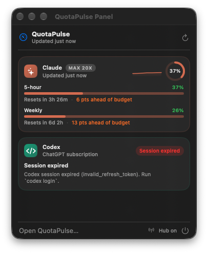
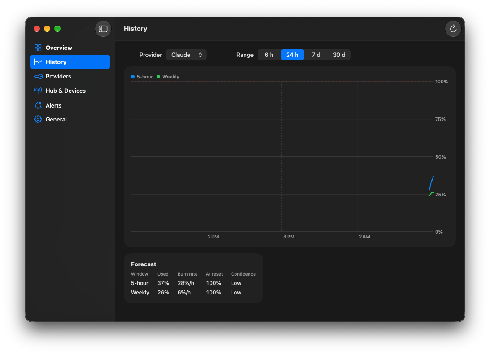
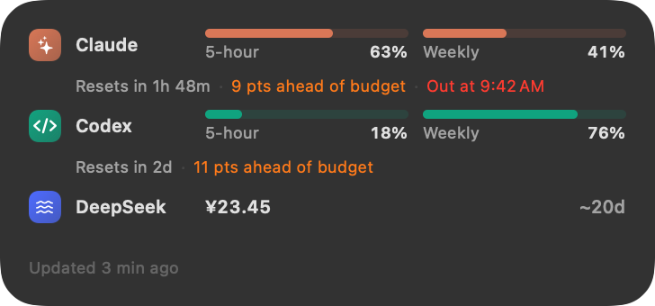
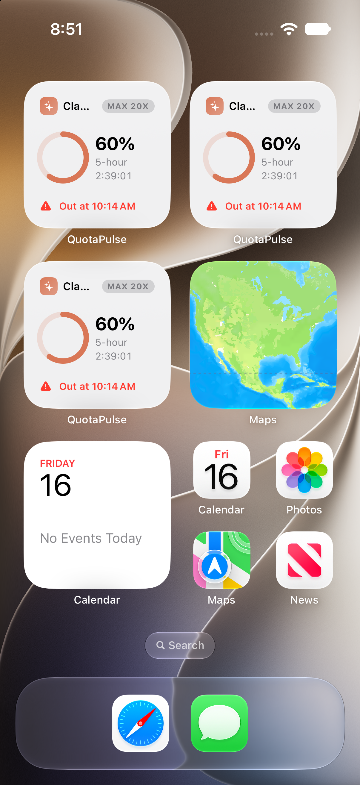
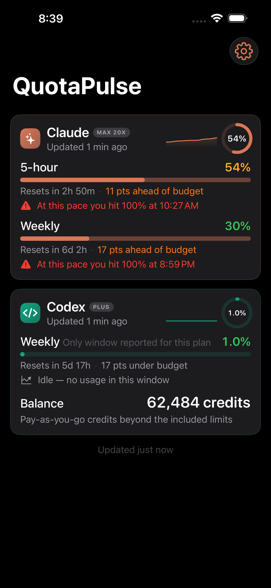
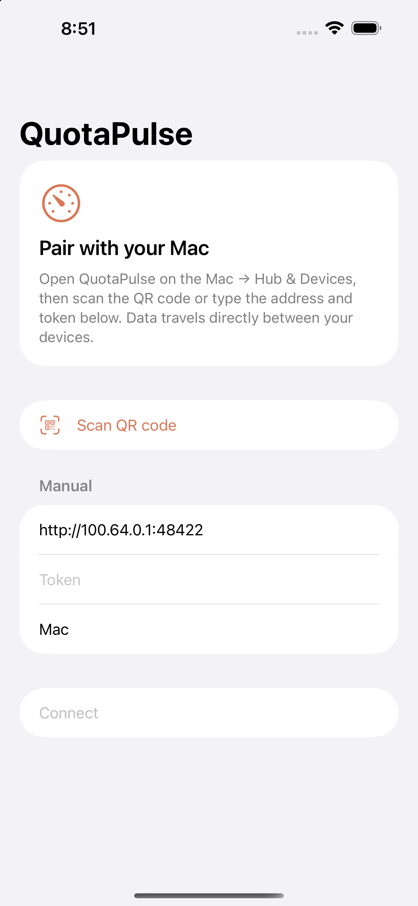
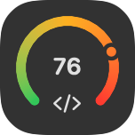

# QuotaPulse

**How much AI do I have left, and when does it run out?** — answered in the macOS menu bar, on the desktop, on your iPhone's home screen and on your wrist.

QuotaPulse watches the rate-limit windows and balances of the AI providers you already use — **Claude** (Claude Code subscription), **OpenAI Codex** (ChatGPT subscription), **DeepSeek** (prepaid balance), **OpenCode Zen/Go**, **GLM / z.ai** and **Grok Bot** (desktop app) — and turns the raw percentages into something actionable:

- *"At this pace you hit 100 % at 18:40 — reset is at 21:00"*
- *"9 pts ahead of budget"* / *"On pace"*
- *"¥1.20/day — about 20 days left"*

Install it on your Mac, and your iPhone and Apple Watch have the numbers wherever you are: no pairing, no VPN, nothing to keep reachable. The Mac reads the credentials your CLIs already keep locally, polls the providers, stores the history and publishes the results to your private iCloud database. Your other devices only ever see those numbers — never a token.

Prefer to stay off iCloud, or want local scripts to read the numbers? The Mac also serves a small authenticated JSON API over your network, and devices can pair with it directly.

| macOS menu bar | macOS main window | History & forecast |
|---|---|---|
|  |  |  |

| Desktop widgets | iPhone 17 · iOS 27 | iPhone 17 · detail | iPhone 17 · home-screen widgets |
|---|---|---|---|
|   |  |  |  |

| iPhone 15 Plus · iOS 26.5 | iPhone 15 Plus · dark, XXL text | Pairing | Apple Watch + complications |
|---|---|---|---|
|  |  |  |    |

Screenshots come from the running apps: the Mac itself, iPhone 17 (iOS 27.0) and iPhone 15 Plus (iOS 26.5 and 27.0) simulators, the watchOS 27 simulator; home-screen widgets were added through the real widget gallery by `QuotaPulseUITests`. Lock-screen accessory widgets and watch complications are rendered from the real widget views (`swift run WidgetRender`).

## Compatibility

| Platform | Verified on | Notes |
|---|---|---|
| macOS | 27.0.1 (Mac mini M4) | Menu bar app + desktop widgets; min macOS 26.0 |
| iOS | **iPhone 17 / iOS 27.0** · **iPhone 15 Plus / iOS 26.5** (API-equivalent to 26.6.2) · iPhone 15 Plus / iOS 27.0 · iPhone Duo / iOS 27.1 | Home, detail, pairing, settings, home-screen widgets, Dynamic Type XXL, dark mode; min iOS 26.0, no iOS-27-only API |
| watchOS | Apple Watch Series 12 / watchOS 27.0 | min watchOS 26.0 |

## Features

**Providers**

| Provider | What it shows | Credentials |
|---|---|---|
| Claude | 5-hour + weekly windows (plus Opus/Sonnet/model-scoped caps when present), extra-usage credits | Read from Claude Code: Keychain `Claude Code-credentials` → `~/.claude/.credentials.json`. Nothing stored. |
| Codex | 5-hour + weekly windows, model-specific limits, plan | `~/.codex/auth.json`; expired sessions are refreshed with the Codex CLI's own client id and written back |
| DeepSeek | Balance (paid / granted), burn per day, days left | API key (Settings or `DEEPSEEK_API_KEY`) |
| OpenCode | Go subscription 5-hour / weekly / monthly | API key (Settings, `OPENCODE_API_KEY`, or opencode's `auth.json`) |
| GLM (z.ai / bigmodel.cn) | Coding-plan limits | API key (Settings or `ZHIPU_API_KEY`) |
| Grok Bot | Weekly usage percent + reset, plan | The signed-in Grok Bot app on this Mac (its session file + Keychain item “Grok Bot Safe Storage”). Nothing stored, never refreshed: open Grok Bot to renew an expired session. Another Mac without the app reads it from iCloud. |

**Reset semantics** — Claude's windows start with your first request and are merely *cleared* at `resets_at` (the next window starts when you next use it), so an expired window reads "Fresh · next window starts on first request" rather than a negative countdown. Codex windows reset on a fixed cadence and roll forward automatically.

**Forecasts** — a least-squares burn rate over the current window (resets and top-ups start a new cycle automatically) gives projected usage at reset, the exhaustion time if you'll hit 100 % early, and a pace indicator against a linear budget. Balances get a per-day burn and days-remaining. Confidence grows with sample count and span.

**macOS** — menu-bar ring + percent for the most constrained window; instant dropdown with per-provider cards, sparklines and reset countdowns; main window with Overview, 24 h / 7 d / 30 d history charts and forecast table, provider settings, iCloud sync, optional hub pairing with QR code, threshold notifications (opt-in, 80 % / 95 %), launch at login. Desktop widgets in small (pick a provider), medium and large.

**iOS** — open it and your numbers are there, delivered through iCloud on any network, with a silent push when the Mac publishes. Provider cards, detail charts, pull-to-refresh, background refresh, home-screen and lock-screen widgets. A banner tells you when the Mac has gone quiet. Pushes data to the watch. A direct connection (scan the QR code or paste URL + token) is optional.

**watchOS** — list + detail, circular / corner / rectangular / inline complications. Reads iCloud on its own, then falls back to a paired hub and the iPhone.

## Install (macOS)

```bash
git clone git@github.com:StevenLi-phoenix/QuotaPulse.git && cd QuotaPulse
# needs xcodegen on PATH or at ../tools/xcodegen/bin/xcodegen
scripts/install.sh      # Release build → ~/Applications/QuotaPulse.app → launch
```

Requirements: macOS 26+, Xcode 27.1, Swift 6.4, and Xcode signed in to an Apple ID on a paid Apple Developer team (iCloud needs a provisioning profile; `install.sh` registers the Mac and fetches it). The app is signed with an Apple Development certificate (team `88U7V98QAC`). To build under your own team, change `DEVELOPMENT_TEAM` in `project.yml`, and rename the iCloud container in `project.yml` and `CloudKitRecordStore.containerID`, since container IDs are global.

First launch: Claude, Codex and Grok Bot are enabled by default and read your CLI sign-ins — if Claude Code is signed in you'll see numbers within seconds. Add API keys for DeepSeek / OpenCode / GLM under **Providers**. QuotaPulse is a menu-bar app: look for the ring + percentage top right (the first launch also opens the main window; *Show in Dock* is under General). The hub starts on port 48422 and writes `pairing.json` (0600) in the app's group container so local scripts can use it:

```bash
P=~/Library/Group\ Containers/88U7V98QAC.app.lishuyu.quotapulse/QuotaPulse/pairing.json
curl -H "Authorization: Bearer $(jq -r .token "$P")" "$(jq -r .baseURL "$P")/v1/snapshot" | jq
```

## Install (iPhone / Apple Watch)

Build the `QuotaPulse-iOS` scheme in Xcode with your own team selected (App Group `group.app.lishuyu.quotapulse` must exist in your developer account for widgets on a real device) and run it on your phone. If the phone is signed in to the same iCloud account as the Mac, that's all: the numbers appear on their own. The watch app is embedded and installs with the iPhone app; complications appear once it has a snapshot.

Direct connection (optional): **Hub & Devices → scan the QR** on the Mac, from **Settings → Direct connection** on the phone. It works on your local network, or through a mesh VPN such as Tailscale (the Mac's `100.x.x.x` address comes first in the pairing picker). It is what sends device logs to the Mac.

## Gateway hub (optional)

Instead of holding the OpenCode and DeepSeek keys on the Mac, point QuotaPulse at a gateway that speaks the hub protocol under a path prefix (default `https://llm.lishuyu.app/llm/hub`). Create `gateway.json` (0600) next to `pairing.json`:

```json
{"baseURL": "https://llm.lishuyu.app/llm/hub", "token": "<gateway key>"}
```

`baseURL` is optional. With the file present, OpenCode and DeepSeek are read from `GET /v1/snapshot` (one request per refresh, shared by both) and the Mac reports Claude, Codex and GLM readings, plus the forecasts it computes for OpenCode and DeepSeek, to `POST /v1/report` (`{providers: [...]}`, no credentials, `account.label` stripped). A failed report is only logged and not retried for 5 minutes. Delete the file to go back to local keys. On the iPhone, **Settings → Direct connection** is pre-filled with the gateway URL; it reads from the gateway but doesn't upload device logs there (it has no telemetry route).

## iCloud sync

On by default. **Hub & Devices → iCloud** on the Mac shows the account and last publish, turns sync off, and deletes what's stored.

- The Mac writes as soon as a number changes, and otherwise every 15 minutes so your devices can tell it's alive. Every 30 minutes it also writes history (7 days, down-sampled) and its raw samples (90 days), then takes back the points the other Macs sampled, so every Mac shows the same charts.
- Settings are one set for the account: the copy changed most recently wins on every Mac.
- API keys, the hub token and the gateway link go through iCloud Keychain, which Apple encrypts end-to-end. A Mac that is signed in to the same iCloud account already has them. Windows, and any device outside that keychain, enters the gateway token by hand.
- iPhone and Watch read iCloud first and ask a paired hub only when the iCloud copy is over 20 minutes old. Whichever snapshot is newest wins.
- After 30 minutes without a new snapshot, the apps say when they last heard from the Mac. Something has to run there: if it's off or asleep, the numbers wait.
- If nothing arrives, compare **iCloud account ID** on the Mac and phone. A mismatch means they're on different iCloud accounts.

## Hub API

Optional: iCloud sync doesn't use it. Local scripts and paired devices do.

| Endpoint | Returns |
|---|---|
| `GET /v1/health` | `{ok, version, hubName, generatedAt}` |
| `GET /v1/snapshot` | the full `QuotaSnapshot` (providers, windows, balances, forecasts) |
| `GET /v1/history?provider=claude&hours=24` | down-sampled samples |
| `POST /v1/report` (gateway only, `{providers: [...]}`) | stores Claude / Codex / GLM readings and OpenCode / DeepSeek forecasts, returns `{accepted}` |
| `POST /v1/telemetry` (`application/x-ndjson`, `X-Device-Name` / `X-App-Version` / `X-Platform`) | stores device logs, returns `{accepted}` |

All need `Authorization: Bearer <token>`. The token lives in the Mac's Keychain (synced through iCloud Keychain) and in `pairing.json`; **New token** in settings rotates it.

## Telemetry & diagnostics

The iPhone and Watch apps keep a JSON Lines log (`Documents/Logs/quotapulse-YYYY-MM-DD.log`, 10 MB cap, visible in the Files app) with pairing, hub fetch latency/status, background refresh, WatchConnectivity, widget reloads and forecast summaries, plus MetricKit crash/hang payloads under `Documents/Diagnostics`. On a device with a direct connection, every refresh pushes the unsent lines to the hub (`POST /v1/telemetry`, same bearer token); logs don't go through iCloud, and without a direct connection they stay on the device. The Mac stores them under `…/QuotaPulse/telemetry/<device>/YYYY-MM-DD.log` and shows every device's last heartbeat, version and last error under **Hub & Devices → Devices**. iOS **Settings → Diagnostics** can also export everything as a zip.

## Development

```bash
cd QuotaCore && swift test                 # 152 unit tests: parsing, forecasting, store, hub, gateway, iCloud sync, keychain
../tools/xcodegen/bin/xcodegen generate    # project.yml → QuotaPulse.xcodeproj
xcodebuild -scheme QuotaPulse-macOS -destination 'platform=macOS' build
xcodebuild -scheme QuotaPulse-iOS -destination 'generic/platform=iOS Simulator' CODE_SIGNING_ALLOWED=NO build
python3 scripts/gen-strings.py             # regenerate en / zh-Hans string catalogs
cd QuotaUI && swift run WidgetRender ../docs/screenshots   # widget PNGs from the real views
```

Layout: `QuotaCore` (models, providers, credentials, forecasting, store, hub, gateway, iCloud sync) · `QuotaUI` (shared SwiftUI) · `macOS/`, `iOS/`, `watchOS/` (apps + widget extensions) · `docs/research.md` (provider endpoints and design decisions).

Logs: `log stream --predicate 'subsystem == "app.lishuyu.quotapulse"'`. Secrets are always redacted (`sk-ant…(len 108)`).

## Privacy & security

- Credentials are read from where your CLIs put them and sent only to that provider. Keys you type are stored in your Keychain and synced through iCloud Keychain, which Apple encrypts end-to-end. Claude Code and Codex logins stay on each Mac.
- The hub binds to all interfaces by default so Tailscale works; turn off *Reachable from other devices* for loopback only. Requests without the bearer token get 401.
- iCloud sync stores the snapshot and history in your own private CloudKit database: usage numbers, plan names, where a credential was read from (`keychain` or `file`), the Mac's name, the settings (no keys or tokens) and the raw samples. API keys and tokens never go into CloudKit; they go through iCloud Keychain. Apple's standard iCloud encryption applies to CloudKit, so these fields are not end-to-end encrypted.
- No analytics, and no servers besides the providers themselves and your iCloud.

## Known limits

- Claude's `/api/oauth/usage` is heavily rate-limited; the default 5-minute poll backs off up to 30 minutes on 429.
- Claude tokens are refreshed by Claude Code itself (opening it once is enough); QuotaPulse's own refresher is off by default to avoid rotating Claude Code's refresh token.
- OpenCode pay-as-you-go spend and DeepSeek per-model usage require web-session cookies and are not supported.
- Widgets on a real iPhone/Watch need the App Group capability on your team; the simulator doesn't check it.
- Right after an App ID first gets the iCloud container, CloudKit can answer `Invalid bundle ID for container`, sometimes for only some requests. On our first iPhone install it lasted about 8 minutes and then stopped. The apps say so and retry every 30 seconds while open.
- Apple Development builds use CloudKit's Development environment, whose schema is created on first write. A TestFlight or App Store build reads Production and needs the schema deployed in CloudKit Console first.
- iCloud keeps one record per provider (`provider.<id>`), one history per provider (`history.<id>`) and the raw samples in pieces (`samples.<id>.<n>`), shared by every Mac on the account. A Mac writes only the providers it has read, a newer reading replaces an older one, and samples from two Macs are merged by provider, window and second. Deleting history leaves a cut-off that every Mac honours. Settings are one record, newest copy wins. Schema 2 needs the iPhone and Watch apps updated together with the Mac app.
- iOS can hold back silent pushes while the app is in the background, so a closed app may only catch up when opened or on its next background refresh.
- The watch doesn't get silent pushes. It refreshes when opened and on its widget timeline, about every 15 minutes at best.
- Unsigned dev builds have no iCloud entitlement, so sync is off and the setting explains why.
